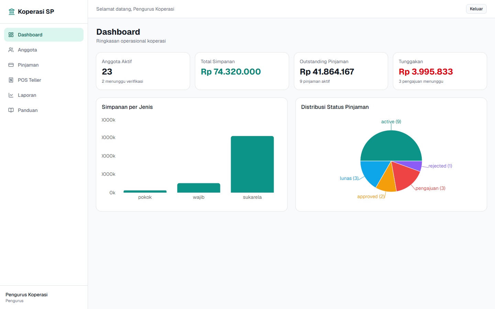
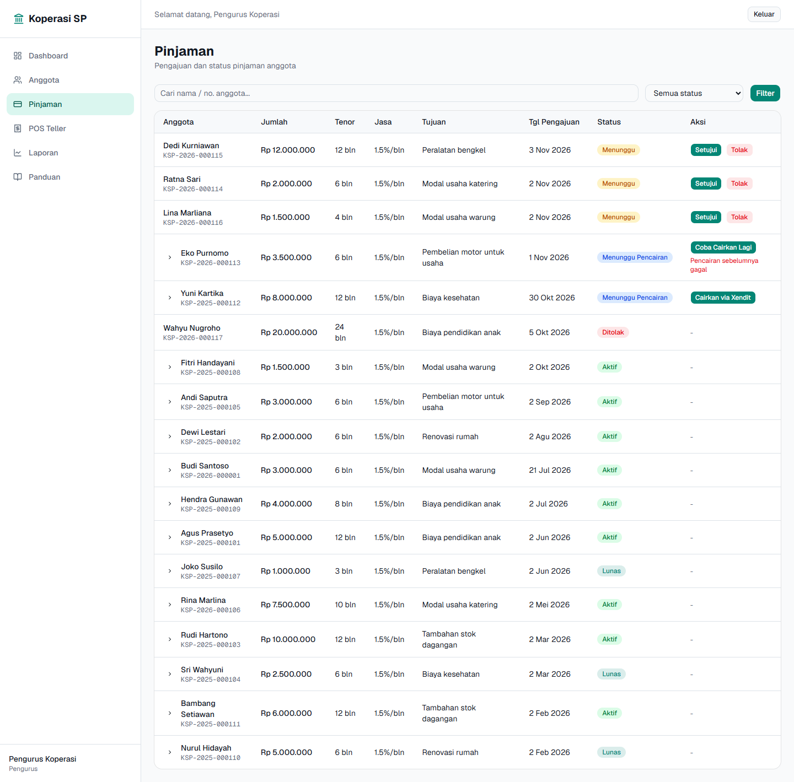
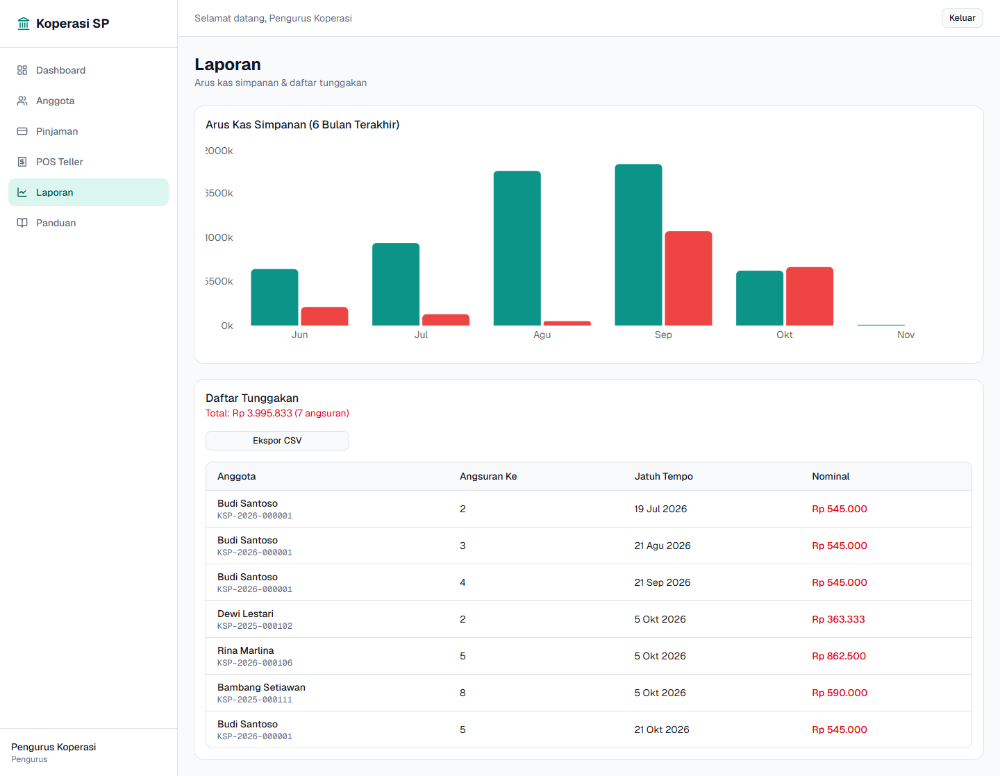
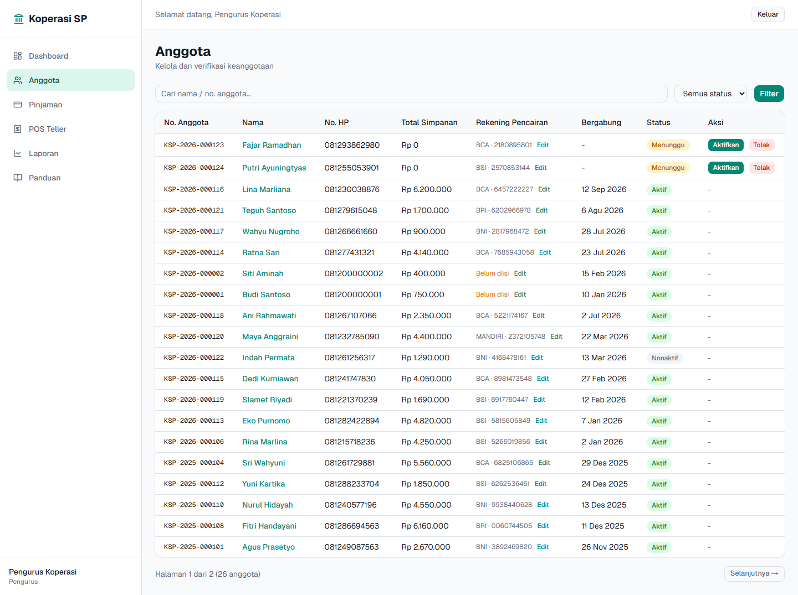

# Koperasi Simpan Pinjam — Savings & Loan Cooperative Platform

End-to-end digital platform for Indonesian savings & loan cooperatives (*koperasi simpan pinjam*): a member mobile app, a staff web dashboard with teller POS, online payments, and automated loan disbursement to bank accounts.

## Live Demo

**Web dashboard:** https://koperasi-simpan-pinjam-red.vercel.app

| Role | Email | Password |
| --- | --- | --- |
| Board (*pengurus*) — approvals, disbursement, reports | `pengurus@koperasi.test` | `password123` |
| Teller — cash POS | `teller@koperasi.test` | `password123` |

Demo runs on sandbox payment keys; no real money moves. Data may be reset.

| Dashboard | Loans |
| --- | --- |
|  |  |
| **Reports** | **Members** |
|  |  |

## The Problem

Many cooperatives still run on paper ledgers and spreadsheets. Members queue at the office to check balances or pay installments, loan approval is manual, and cash handling is error-prone with no audit trail.

## The Solution

| App | Users | What it does |
| --- | --- | --- |
| **Mobile** (`mobile/`, Flutter) | Members | Check savings balances, apply for loans, pay installments and deposits online, KTP e-KYC capture, digital member card, push notifications |
| **Web** (`web/`, Next.js) | Tellers & board | Member management, loan approval, one-click disbursement, teller POS for cash deposit/withdrawal/installments, reports & charts |
| **Backend** (`supabase/`) | — | Postgres schema, row-level security, business logic in SQL RPCs/triggers, Edge Functions for payments and reminders |

## Highlights

- **Money logic is server-side only.** Balances are updated by Postgres triggers (`apply_savings_txn` rejects overdrafts); loan approval generates the installment schedule in a single RPC (`rpc_approve_pinjaman`). Clients never compute amounts.
- **Payment gateway integration (Xendit).** Invoices for deposits and installments via `create-payment`; `payment-webhook` verifies the Xendit callback token before posting any transaction. Providers sit behind a `PaymentProvider` abstraction (migrated from Midtrans to Xendit without touching app code).
- **Automated loan disbursement.** `create-disbursement` sends funds to the member's bank account via Xendit Disbursement; the loan only becomes `active` after a `COMPLETED` webhook, and stays retryable on `FAILED`.
- **Role-based security with RLS.** Members see only their own data; tellers and board members get scoped access (`anggota` / `teller` / `pengurus`).
- **Scheduled reminders.** `pg_cron` + Firebase Cloud Messaging push installment due-date reminders.

## Tech Stack

| Layer | Technology |
| --- | --- |
| Mobile | Flutter 3, Riverpod, go_router, supabase_flutter, Firebase Messaging, camera |
| Web | Next.js 16 (App Router), React 19, TypeScript, Tailwind CSS 4, shadcn/ui, Recharts, @supabase/ssr |
| Backend | Supabase (Postgres, Auth, Storage, Realtime, Edge Functions), pg_cron |
| Payments | Xendit Invoice & Disbursement |

Data model and business rules: [`docs/ERD.md`](docs/ERD.md).

## Quick Start

Full guide: [`docs/SETUP.md`](docs/SETUP.md).

```bash
# 1. Local Supabase (requires Docker)
npx supabase start
npx supabase db reset   # apply migrations + seed

# 2. Web
cd web && cp .env.local.example .env.local   # fill in credentials
npm run dev

# 3. Mobile
cd mobile && cp .env.example .env             # fill in credentials
flutter run --dart-define-from-file=.env
```

Edge Function secrets: copy `supabase/functions/.env.example` to `supabase/functions/.env` (git-ignored).

## Hosting Cost (Supabase)

- **Free**: $0 — enough for MVP and development.
- **Pro**: ~$25/month — early production (8 GB DB, 100k MAU, daily backups, no auto-pause).
- Can be **self-hosted** (open source) to avoid vendor lock-in.
