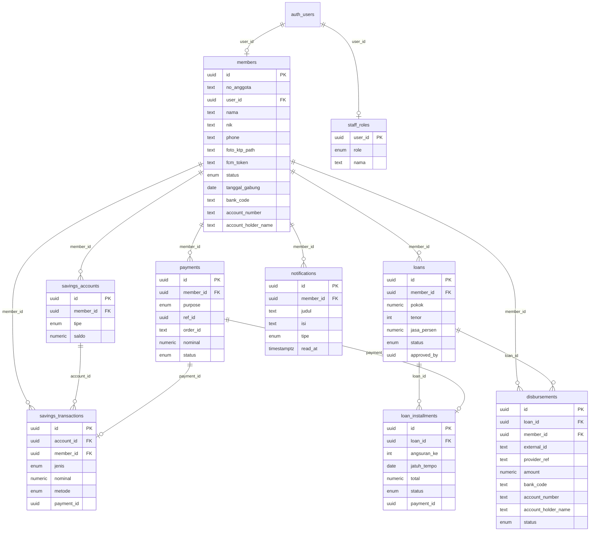

# Entity Relationship Diagram

Skema database Koperasi Simpan Pinjam (Postgres/Supabase).

## Aturan Bisnis Utama

- **Simpanan**: 3 rekening (pokok/wajib/sukarela) dibuat otomatis saat anggota
  dibuat (trigger `create_default_savings`). Saldo diupdate otomatis oleh trigger
  `apply_savings_txn` (menolak penarikan melebihi saldo).
- **Pinjaman**: pengajuan oleh anggota (`rpc_ajukan_pinjaman`), disetujui pengurus
  (`rpc_approve_pinjaman`) yang otomatis membuat jadwal angsuran (jasa flat per
  bulan dari pokok) dan mengubah status menjadi `approved` (menunggu pencairan).
- **Pencairan**: pengurus mencairkan pinjaman `approved` via Edge Function
  `create-disbursement` (Xendit Disbursement) ke rekening bank anggota. Status
  pinjaman baru menjadi `active` setelah `disbursement-webhook` menerima callback
  `COMPLETED`; jika `FAILED`, pinjaman tetap `approved` agar bisa dicairkan ulang.
- **Pembayaran**: mutasi keuangan via gateway ditangani `payment-webhook` dengan
  service role (setelah verifikasi callback token Xendit). Transaksi tunai via RPC
  `rpc_setor_tunai` / `rpc_tarik_tunai` / `rpc_bayar_angsuran_tunai` (khusus staff).
- **Keamanan**: RLS memastikan anggota hanya melihat datanya sendiri; staff sesuai
  peran. Semua perhitungan uang dieksekusi server-side.
