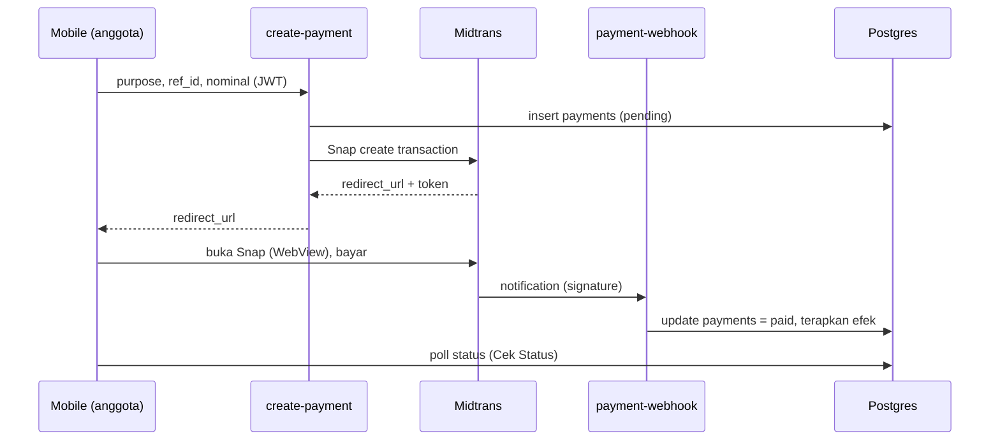

# Panduan Setup

Dokumen ini menjelaskan cara menjalankan seluruh sistem (Supabase, Web, Mobile,
Payment gateway, FCM) dari nol.

## Prasyarat

- Docker Desktop (untuk Supabase lokal)
- Node.js 20+ dan npm
- Flutter 3.4+ (Dart 3.11+)
- Supabase CLI (`npx supabase ...` sudah cukup, tidak perlu install global)
- Akun sandbox Midtrans (gratis) - opsional untuk uji pembayaran
- Project Firebase (gratis) - opsional untuk push notification

---

## 1. Backend (Supabase)

### 1.1 Jalankan Supabase lokal

```bash
cd koperasi-simpan-pinjam
npx supabase start
```

Perintah ini menampilkan kredensial lokal:

- `API URL` -> dipakai sebagai `SUPABASE_URL` / `NEXT_PUBLIC_SUPABASE_URL`
- `anon key` -> `SUPABASE_ANON_KEY` / `NEXT_PUBLIC_SUPABASE_ANON_KEY`
- `service_role key` -> hanya untuk server (Edge Functions)

### 1.2 Terapkan schema + seed

```bash
npx supabase db reset
```

Perintah ini menjalankan seluruh migration di `supabase/migrations/` lalu
memuat `supabase/seed.sql`.

Akun demo (password semua: `password123`):

| Email                  | Peran    | Akses          |
| ---------------------- | -------- | -------------- |
| pengurus@koperasi.test | pengurus | Web dashboard  |
| teller@koperasi.test   | teller   | Web dashboard  |
| budi@koperasi.test     | anggota  | Mobile app     |
| siti@koperasi.test     | anggota  | Mobile app     |

### 1.3 Deploy ke Supabase Cloud (produksi)

```bash
npx supabase link --project-ref <project-ref>
npx supabase db push          # apply migrations ke cloud
npx supabase functions deploy create-payment payment-webhook reminder
```

---

## 2. Edge Functions & Secrets

Salin `supabase/functions/.env.example` menjadi `supabase/functions/.env` dan isi
kredensial Midtrans/FCM.

Jalankan lokal:

```bash
npx supabase functions serve --env-file supabase/functions/.env
```

Set secrets di cloud:

```bash
npx supabase secrets set --env-file supabase/functions/.env
```

| Function          | verify_jwt | Pemanggil                     |
| ----------------- | ---------- | ----------------------------- |
| `create-payment`  | true       | Mobile app (JWT anggota)      |
| `payment-webhook` | false      | Midtrans (signature verified) |
| `reminder`        | false      | pg_cron / manual              |

---

## 3. Payment Gateway (Midtrans Sandbox)

1. Daftar di https://dashboard.sandbox.midtrans.com
2. Menu **Settings > Access Keys**: salin `Server Key` dan `Client Key`.
3. Isi `MIDTRANS_SERVER_KEY` di `supabase/functions/.env`.
4. Menu **Settings > Configuration**: set **Payment Notification URL** ke:
   `https://<project-ref>.functions.supabase.co/payment-webhook`
   (untuk lokal, gunakan tunnel seperti ngrok yang mengarah ke port functions).
5. Uji pembayaran memakai kartu/VA simulator Midtrans.

Alur pembayaran:



---

## 4. Web (Next.js)

```bash
cd web
cp .env.local.example .env.local   # isi URL + anon key
npm install
npm run dev                        # http://localhost:3000
```

Login pakai akun `pengurus@` atau `teller@`. Anggota tidak bisa masuk (ditolak).

---

## 5. Mobile (Flutter)

```bash
cd mobile
cp ../.env.example .env             # isi SUPABASE_URL + SUPABASE_ANON_KEY
flutter pub get
flutter run --dart-define-from-file=.env
```

> Catatan: untuk emulator Android, `SUPABASE_URL` lokal harus `http://10.0.2.2:54321`
> (bukan `127.0.0.1`). Untuk device fisik gunakan IP LAN komputer.

Login pakai `budi@koperasi.test` / `password123`.

---

## 6. Push Notification (FCM) - Opsional

1. Buat project di https://console.firebase.google.com (gratis).
2. Konfigurasi Flutter:
   ```bash
   dart pub global activate flutterfire_cli
   cd mobile && flutterfire configure
   ```
   Ini menghasilkan `firebase_options.dart` + `google-services.json` (Android) /
   `GoogleService-Info.plist` (iOS). Aplikasi otomatis mengaktifkan FCM.
3. Untuk mengirim push dari server, buat **Service Account** di Firebase
   (Project Settings > Service accounts > Generate new private key) lalu isi
   `FCM_PROJECT_ID`, `FCM_CLIENT_EMAIL`, `FCM_PRIVATE_KEY` di `functions/.env`.

Tanpa konfigurasi ini, notifikasi **in-app** tetap berjalan (dibuat oleh
`generate_due_reminders()` via pg_cron); hanya push perangkat yang nonaktif.

---

## 7. Penjadwalan Reminder (pg_cron)

Migration `20260721000005_cron_reminders.sql` mengaktifkan `pg_cron` + `pg_net`,
membuat fungsi `generate_due_reminders()`, dan menjadwalkannya tiap hari 08:00.

Untuk juga mengirim push tiap hari, jadwalkan pemanggilan Edge Function
`reminder` via `pg_net` (contoh, jalankan sekali di SQL editor cloud):

```sql
select cron.schedule(
  'daily-reminder-push',
  '5 8 * * *',
  $$
  select net.http_post(
    url := 'https://<project-ref>.functions.supabase.co/reminder',
    headers := jsonb_build_object(
      'Authorization', 'Bearer <SERVICE_ROLE_KEY>',
      'Content-Type', 'application/json'
    ),
    body := '{}'::jsonb
  );
  $$
);
```
