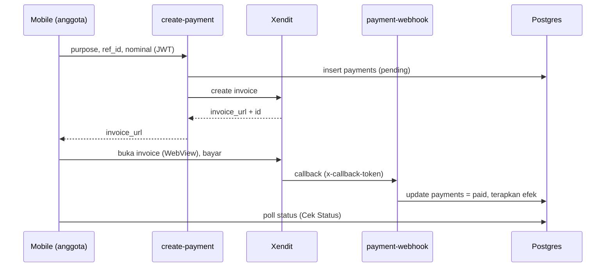
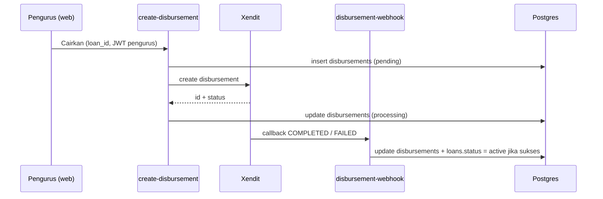

# Panduan Setup

Dokumen ini menjelaskan cara menjalankan seluruh sistem (Supabase, Web, Mobile,
Payment gateway, FCM) dari nol.

## Prasyarat

- Docker Desktop (untuk Supabase lokal)
- Node.js 20+ dan npm
- Flutter 3.4+ (Dart 3.11+)
- Supabase CLI (`npx supabase ...` sudah cukup, tidak perlu install global)
- Akun Xendit (gratis, mode Test) - opsional untuk uji pembayaran
- Project Firebase (gratis) - opsional untuk push notification

---

## 1. Backend (Supabase)

### 1.1 Jalankan Supabase lokal

```bash
cd koperasi-simpan-pinjam
npx supabase start
```

Perintah ini menampilkan kredensial lokal:

- `API URL` -> dipakai sebagai `SUPABASE_URL` / `NEXT_PUBLIC_SUPABASE_URL`
- `anon key` -> `SUPABASE_ANON_KEY` / `NEXT_PUBLIC_SUPABASE_ANON_KEY`
- `service_role key` -> hanya untuk server (Edge Functions)

### 1.2 Terapkan schema + seed

```bash
npx supabase db reset
```

Perintah ini menjalankan seluruh migration di `supabase/migrations/` lalu
memuat `supabase/seed.sql`.

Akun demo (password semua: `password123`):

| Email                  | Peran    | Akses          |
| ---------------------- | -------- | -------------- |
| pengurus@koperasi.test | pengurus | Web dashboard  |
| teller@koperasi.test   | teller   | Web dashboard  |
| budi@koperasi.test     | anggota  | Mobile app     |
| siti@koperasi.test     | anggota  | Mobile app     |

Data demo tambahan (24 anggota, riwayat simpanan 6+ bulan, pinjaman di semua
status, pencairan & tunggakan) untuk showcase. Aman dijalankan ulang untuk
me-reset data demo; data `seed.sql` tidak tersentuh:

```bash
npx supabase db query -f supabase/demo-seed.sql            # lokal
npx supabase db query --remote -f supabase/demo-seed.sql   # cloud
```

### 1.3 Deploy ke Supabase Cloud (produksi)

```bash
npx supabase link --project-ref <project-ref>
npx supabase db push          # apply migrations ke cloud
npx supabase functions deploy create-payment payment-webhook create-disbursement disbursement-webhook reminder
```

---

## 2. Edge Functions & Secrets

Salin `supabase/functions/.env.example` menjadi `supabase/functions/.env` dan isi
kredensial Xendit/FCM.

Jalankan lokal:

```bash
npx supabase functions serve --env-file supabase/functions/.env
```

Set secrets di cloud:

```bash
npx supabase secrets set --env-file supabase/functions/.env
```

| Function                | verify_jwt | Pemanggil                         |
| ----------------------- | ---------- | --------------------------------- |
| `create-payment`        | true       | Mobile app (JWT anggota)          |
| `payment-webhook`       | false      | Xendit (callback token verified)  |
| `create-disbursement`   | true       | Web dashboard (JWT pengurus)      |
| `disbursement-webhook`  | false      | Xendit (callback token verified)  |
| `reminder`              | false      | pg_cron / manual                  |

---

## 3. Payment Gateway (Xendit)

1. Daftar di https://dashboard.xendit.co (gunakan mode **Test** untuk sandbox).
2. Menu **Settings > API Keys**: buat Secret Key dengan permission **Invoices =
   Write** (dan **Disbursements = Write**, lihat bagian 3.1), salin ke
   `XENDIT_SECRET_KEY` di `supabase/functions/.env`.
3. Menu **Settings > Webhooks**: salin **Callback Verification Token** ke
   `XENDIT_CALLBACK_TOKEN`, lalu set URL webhook **Invoices paid** ke:
   `https://<project-ref>.functions.supabase.co/payment-webhook`
   (untuk lokal, gunakan tunnel seperti ngrok yang mengarah ke port functions).
4. Uji pembayaran memakai simulator VA/e-wallet di dashboard Xendit.

Alur pembayaran:



### 3.1 Pencairan Pinjaman (Xendit Disbursement)

1. Di API Key yang sama (langkah 3.2), pastikan permission **Disbursements =
   Write** aktif. Semua permission lain (VA, e-wallet, cards, retail outlets,
   money-out lain, saldo, report, xenPlatform, dll.) tetap **None**.
2. Menu **Settings > Webhooks**: set URL webhook **Disbursement** ke:
   `https://<project-ref>.functions.supabase.co/disbursement-webhook`
   (memakai Callback Verification Token yang sama dengan langkah 3.3).
3. Isi rekening bank anggota (kode bank, no. rekening, nama pemilik) di
   halaman **Anggota** pada web dashboard sebelum mencairkan pinjaman. Kode
   bank yang didukung Xendit antara lain `BCA`, `BNI`, `BRI`, `MANDIRI`,
   `CIMB`, `PERMATA`.
4. Setelah pengurus **Setujui** pengajuan pinjaman (status menjadi
   `approved` / "Menunggu Pencairan"), klik **Cairkan via Xendit** di halaman
   **Pinjaman**. Uji dengan data simulasi Xendit test mode untuk hasil
   `COMPLETED` atau `FAILED`.

> Catatan: Disbursement (money-out) di akun Xendit **Live** umumnya memerlukan
> verifikasi dokumen legal bisnis terlebih dahulu. Mode **Test** tetap bisa
> dipakai untuk uji alur ini tanpa verifikasi.

Alur pencairan:



---

## 4. Web (Next.js)

```bash
cd web
cp .env.local.example .env.local   # isi URL + anon key
npm install
npm run dev                        # http://localhost:3000
```

Login pakai akun `pengurus@` atau `teller@`. Anggota tidak bisa masuk (ditolak).

---

## 5. Mobile (Flutter)

```bash
cd mobile
cp ../.env.example .env             # isi SUPABASE_URL + SUPABASE_ANON_KEY
flutter pub get
flutter run --dart-define-from-file=.env
```

> Catatan: untuk emulator Android, `SUPABASE_URL` lokal harus `http://10.0.2.2:54321`
> (bukan `127.0.0.1`). Untuk device fisik gunakan IP LAN komputer.

Login pakai `budi@koperasi.test` / `password123`.

---

## 6. Push Notification (FCM) - Opsional

1. Buat project di https://console.firebase.google.com (gratis).
2. Konfigurasi Flutter:
   ```bash
   dart pub global activate flutterfire_cli
   cd mobile && flutterfire configure
   ```
   Ini menghasilkan `firebase_options.dart` + `google-services.json` (Android) /
   `GoogleService-Info.plist` (iOS). Aplikasi otomatis mengaktifkan FCM.
3. Untuk mengirim push dari server, buat **Service Account** di Firebase
   (Project Settings > Service accounts > Generate new private key) lalu isi
   `FCM_PROJECT_ID`, `FCM_CLIENT_EMAIL`, `FCM_PRIVATE_KEY` di `functions/.env`.

Tanpa konfigurasi ini, notifikasi **in-app** tetap berjalan (dibuat oleh
`generate_due_reminders()` via pg_cron); hanya push perangkat yang nonaktif.

---

## 7. Penjadwalan Reminder (pg_cron)

Migration `20260721000005_cron_reminders.sql` membuat `generate_due_reminders()`.
Migration `20260721000009` + `000010` menjadwalkan job `daily-reminder-push` (08:00)
yang memanggil `invoke_daily_reminder()`.

- **Tanpa konfigurasi ekstra**: job hanya membuat notifikasi **in-app**.
- **Dengan push FCM**: isi tabel `app_config` di **SQL Editor** dashboard
  (jangan pakai `ALTER DATABASE SET` — ditolak di Supabase Cloud):

```sql
insert into app_config (key, value) values
  (
    'edge_reminder_url',
    'https://<project-ref>.functions.supabase.co/reminder'
  ),
  (
    'service_role_key',
    '<SERVICE_ROLE_KEY>'  -- Project Settings > API > service_role
  )
on conflict (key) do update
  set value = excluded.value, updated_at = now();
```

Lokal (contoh URL):

```sql
insert into app_config (key, value) values
  ('edge_reminder_url', 'http://host.docker.internal:54321/functions/v1/reminder'),
  ('service_role_key', '<SERVICE_ROLE_KEY>')
on conflict (key) do update
  set value = excluded.value, updated_at = now();
```

Setelah itu, job akan memanggil Edge Function `reminder` (in-app + FCM push).
Pastikan `FCM_*` sudah di-set sebagai secrets functions (lihat §6).

Uji manual:

```bash
curl -X POST 'https://<project-ref>.functions.supabase.co/reminder' \
  -H "Authorization: Bearer <SERVICE_ROLE_KEY>" \
  -H "Content-Type: application/json" \
  -d '{}'
```
